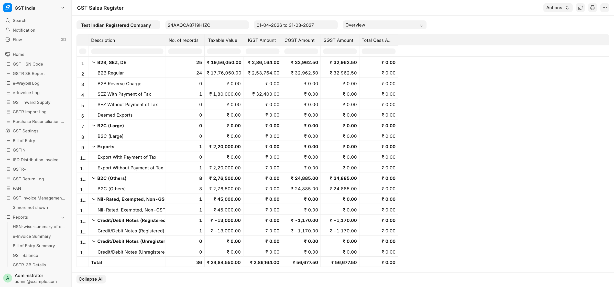
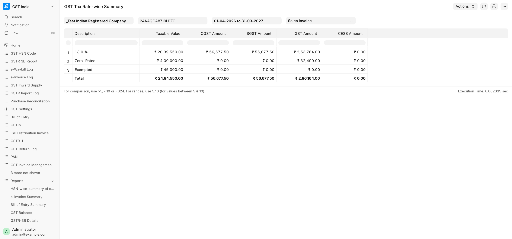
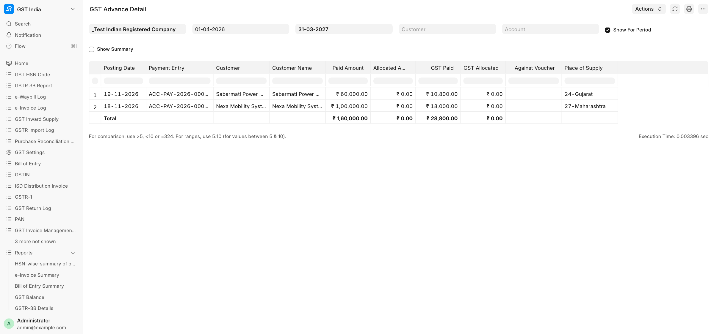
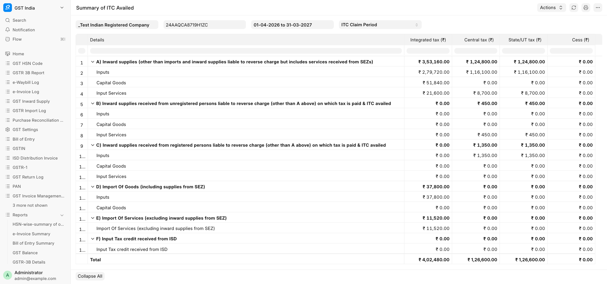
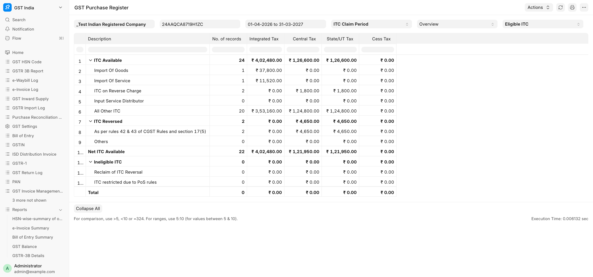
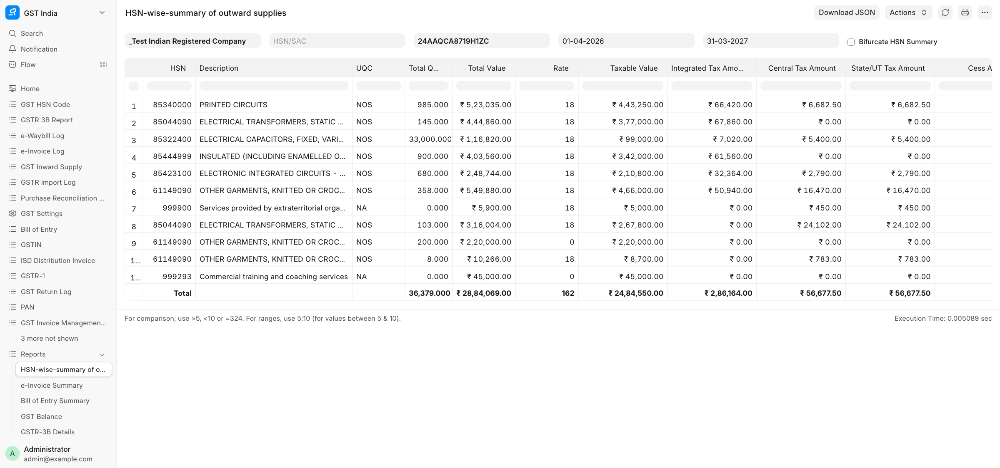
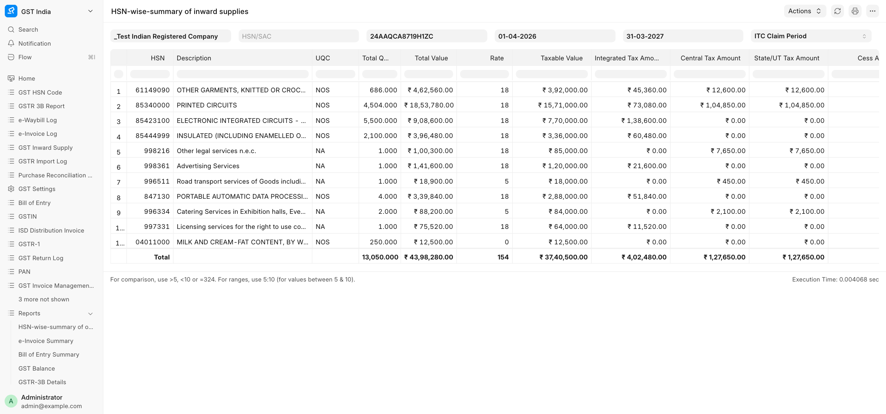
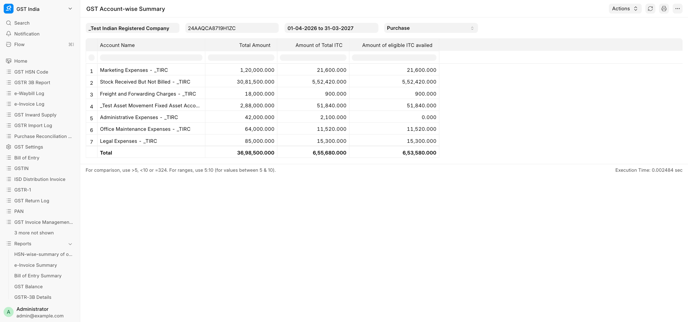

# GSTR-9 Annual Return

India Compliance doesn't generate GSTR-9 yet. Run the reports on this page for the
full financial year, then copy the numbers into GSTR-9 on the GST portal.

Open any report by searching its name in the awesomebar. Set these filters on every
report:

- **Date Range:** the full financial year, for example 01-04-2025 to 31-03-2026.
- **Company GSTIN:** one GSTIN at a time. You file one GSTR-9 per GSTIN.
- **Filter By:** ITC Claim Period, where the report has it. Your ITC then matches
  the months you claimed it in GSTR-3B.

## Which report fills which table

| GSTR-9 table | What it asks for | Report |
| --- | --- | --- |
| 4A to 4E, 4I, 4J | Supplies on which you paid tax: B2C, B2B, exports and SEZ with tax, deemed exports, credit and debit notes | [GST Sales Register](#gst-sales-register) |
| 4F | Advances received with tax paid, invoice not yet issued | [GST Advance Detail](#gst-advance-detail) |
| 4G | Purchases on which you paid tax under reverse charge | [GST Tax Rate-wise Summary](#gst-tax-rate-wise-summary) |
| 5A to 5F, 5H, 5I | Supplies without tax: exports and SEZ without tax, reverse charge sales, exempt, nil rated, non-GST, and their notes | [GST Sales Register](#gst-sales-register), [GST Tax Rate-wise Summary](#gst-tax-rate-wise-summary) |
| 6B to 6G | ITC availed, split into inputs, capital goods and input services | [Summary of ITC Availed](#summary-of-itc-availed) |
| 6H, 7 | ITC reclaimed and ITC reversed | [GST Purchase Register](#gst-purchase-register) |
| 8B to 8D | ITC in your books against GSTR-2B (8A comes from the portal) | [Summary of ITC Availed](#summary-of-itc-availed), [Purchase Reconciliation Tool](/docs/purchase-reconciliation/reconciling_purchase) |
| 9 | Tax paid | Comes from your filed GSTR-3B. Tie it to your books with [GST Balance](/docs/gst-reports/miscellaneous_reports#gst-balance-report) |
| 17 | HSN summary of outward supplies | [HSN-wise-summary of outward supplies](#hsn-wise-summary-of-outward-and-inward-supplies) |
| 18 | HSN summary of inward supplies | [HSN-wise-summary of inward supplies](#hsn-wise-summary-of-outward-and-inward-supplies) |

Fill the rest from your own records: 6K to 6M (transition credit), 10 to 16, and 19.

## GST Sales Register

Set **Summary By** to **Overview**. Each row is a GSTR-1 category, totalled for the year.

| Row | GSTR-9 table |
| --- | --- |
| B2C (Large) and B2C (Others) | 4A |
| B2B Regular | 4B |
| Export With Payment of Tax | 4C |
| SEZ With Payment of Tax | 4D |
| Deemed Exports | 4E |
| Credit/Debit Notes (Registered) and (Unregistered) | 4I for credit notes, 4J for debit notes |
| Export Without Payment of Tax | 5A |
| SEZ Without Payment of Tax | 5B |
| B2B Reverse Charge | 5C |
| Nil-Rated, Exempted, Non-GST | 5D to 5F, split with [GST Tax Rate-wise Summary](#gst-tax-rate-wise-summary) |

To split credit notes from debit notes, set **Summary By** to **Summary by Item** and
pick the notes category in **Invoice Category**. The **Is Return** and **Is Debit Note**
columns mark each note.

## GST Tax Rate-wise Summary

Totals taxable value and tax by GST rate. Change **Voucher Type** for each table:

- **Sales Invoice:** the Exempted, Nil-Rated and Non-GST rows give 5D, 5E and 5F.
- **Purchase Reverse Charge:** gives 4G, including import of services booked with
  **Is Reverse Charge** ticked.
- **Sales Reverse Charge:** cross-checks 5C.

The same rate-wise totals help with the rate-wise tax reconciliation in GSTR-9C.

## GST Advance Detail

Tick **Show For Period** and set From Date and To Date to the financial year. The
report lists advances received with GST, and how much of each was adjusted against
an invoice.

For 4F, take the part not yet adjusted: **Paid Amount** less **Allocated Amount**, and
**GST Paid** less **GST Allocated**.

## Summary of ITC Availed

The rows match GSTR-9 table 6 one to one, so you can copy them across:

| Report row | GSTR-9 table |
| --- | --- |
| A) Inward supplies (other than imports and reverse charge) | 6B |
| B) From unregistered persons under reverse charge | 6C |
| C) From registered persons under reverse charge | 6D |
| D) Import of goods | 6E |
| E) Import of services | 6F |
| F) ITC received from ISD | 6G |

The report splits each row into inputs, capital goods and input services:

- **Capital goods:** items marked **Is Fixed Asset**.
- **Input services:** items with an HSN code starting with 99 (SAC).
- **Inputs:** everything else.

Check those 2 fields on your items before you file. Row A plus the reclaimed ITC from
the [GST Purchase Register](#gst-purchase-register) is your 8B.

## GST Purchase Register

Set **Summary By** to **Overview** and **Sub Section** to **Eligible ITC**.

- **ITC Reversed** rows give table 7. Rules 42 and 43 and section 17(5) share one row.
  To split it, set **Summary By** to **Summary by Invoice**. Purchase invoices and
  bills of entry in that row go to 7E (section 17(5)). Journal entries go to 7C and 7D
  (rules 42 and 43). The **Others** row goes to 7H.
- **Reclaim of ITC Reversal** gives 6H.
- **ITC Available** matches 6A, the ITC you claimed in GSTR-3B for the year. A gap
  means your books and your filed returns differ.

## HSN-wise summary of outward and inward supplies

Both reports list taxable value, rate and tax for each HSN code.

- **HSN-wise-summary of outward supplies** gives table 17.
- **HSN-wise-summary of inward supplies** gives table 18.

## GST Account-wise Summary

Not a GSTR-9 table, but useful for GSTR-9C and for tying ITC to your books. With
**Voucher Type** set to **Purchase**, it shows each expense account with its total
amount, total ITC and eligible ITC availed.

